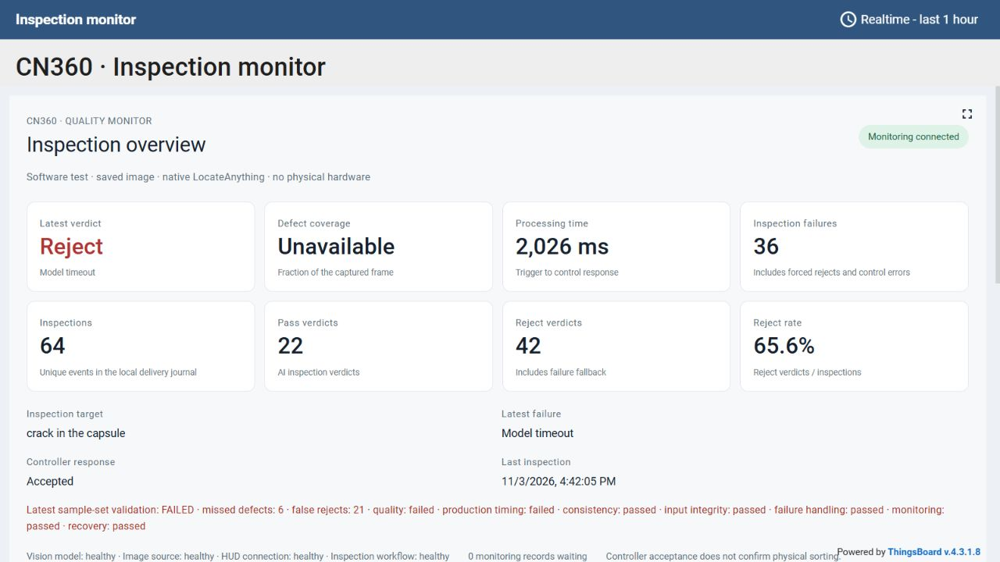

# Native LocateAnything software assessment — 3 November 2026

**Decision: not ready for physical integration.** The monitored native software
path works, but the frozen sample-set quality and production-model timing gates
fail. Cross-service consistency passes. No physical sorting was accepted.

The project owner approved zero misses and zero false rejects for this sample
set before the scored run. Existing model and controller deadlines were kept.
See the final [readiness decision](review-verified/readiness.json) and
[native prediction gallery](review-verified/gallery.html). The review-verified
run repeats the frozen evaluation after strengthening the acceptance checks.
The initial run remains alongside this report for comparison.

## Results

| Gate | Result | Evidence |
| --- | --- | --- |
| Native connection | Verified | Actual CUDA0 model → n8n → PC controller → actual Supabase/relay/HUD/ThingsBoard |
| Sample quality | Failed | 45/45 diagnostic predictions evaluated; 21/21 good attempts falsely rejected; 6/24 defective attempts missed |
| Production model timing | Failed | Two of three bounded inspections timed out; the cracked capsule completed but incorrectly passed |
| Controller response timing | Observed within window | Final software response upper bounds 1839–2514 ms; not physical movement timing |
| Normal dashboard visibility | Passed in measured cases | Three final native results visible in 2139–2789 ms |
| Cross-service consistency | Passed | Native joined records plus ten explicitly injected integration/failure scenarios |
| Input integrity | Passed | Run-local JPEG bytes, snapshot hashes, native geometry and backend verified |
| Failure fallback | Passed | Actual PC controller rejects error cases and ignores expired replies |
| Monitoring and outage recovery | Passed | Actual 10002 ms health-heartbeat interval; real platform shutdown/replay passed |
| Physical operation | Unverified, not authorized | Saved pictures and controller core on PC; no sensor, actuator or conveyor acceptance |

The 45 native predictions cover 15 image/target pairs, each repeated three
times. All seven normal image/target pairs were falsely rejected in all three
repetitions. The hazelnut-hole and cracked-capsule pairs were missed in all
three repetitions. Eighteen defective attempts were correctly rejected. The
successful-evaluation accuracy is 40% on this curated set; it is not an estimate
of general production accuracy.

Final diagnostic HTTP p50 was 1041 ms, p95 1609 ms and maximum 1680 ms. The diagnostic
service allowed 120 seconds to obtain quality measurements. It cannot approve
the production service's 1100 ms allowance, n8n's 1200 ms model budget or the
controller's 3000 ms Verdict Window.

## Evidence and scope

- [Frozen protocol](review-verified/frozen-protocol.json): approved criteria, case/target labels,
  original and served-image hashes, source revision, model and library hashes,
  fixed preparation and repetitions.
- [Production observations](review-verified/production.json): actual n8n executions and model
  outputs, PC controller receipts, cloud Inspection Results/Control Actions,
  snapshot hashes, raw HUD messages and ThingsBoard values for three cases.
- [Native diagnostic predictions](review-verified/diagnostic.json): all 45 actual predictions,
  boxes, coverage/Verdicts, backend and timing diagnostics, with case summaries.
- [Consistency run](review-verified/consistency.json): ten controlled scenarios through real
  n8n, the actual C++ controller core, actual cloud audit and actual relay/
  ThingsBoard. Fault responses are injected and excluded from native quality
  metrics. Controller virtual time is not a physical latency measurement.
- [Monitoring qualification](review-verified/monitoring.json) and
  [actual shutdown/recovery](review-verified/monitoring-recovery.json) provide
  independent evidence for their acceptance gates.
- [Verification checks](verification.json) and [two-axis code review](review.md).

The final run retains its own prepared JPEG files. Actual bytes are hashed at
measurement and finalization; a changed shared software-demo preparation cannot
change the gallery. Snapshot acquisition failures survive rechecking. Missing
fallback, integrity, monitoring or recovery evidence cannot produce readiness.
Prompt verification and threshold availability are explicit in telemetry,
preventing a prior known value from masquerading as a current unknown value.

The consistency scenarios cover pass, reject, model error, model timeout, model
unavailability, failed capture, malformed box geometry, prompt mismatch, an
expired controller reply and recovery. The pass scenario also verifies a
duplicate notification does not resolve another item or inflate inspection
counts. Existing unchanged ThingsBoard shutdown/replay evidence remains in
the preceding software integration report.

The HUD comparison uses its actual contract: status, reason, frame identity,
dimensions and every box. Defect Coverage is compared where it is published
(Inspection Results and ThingsBoard), rather than inventing a HUD coverage
field. Stored snapshot bytes match their prepared input hashes. Raw evidence
is retained when a model decision is wrong or censored by a timeout.

## Reproduce

Use the installed Python environment, q8 model and CUDA bridge from the local
LocateAnything checkout. The source revision is
`77376ab332de918220f7a7e391542eefb5407c9f`; its existing unrelated changes were
left untouched. CUDA0 was explicitly selected and checked at readiness. The
native service reports genuine model startup and warm-up before software-ready
status. Images are JPEG with maximum side 448 pixels, as recorded in the
protocol; the model remains q8/hybrid with six threads.

From the project root, stop only the owned software profile and select native:

```powershell
./n8n/scripts/stop-software-bench.ps1
./thingsboard/scripts/start-native.ps1 -LocateAnythingPath D:\CN360\locate-anything.cpp
```

Wait for `Software test ready` in the software supervisor log, then select a
labelled case at the saved-picture test page. Its Inspection Target is committed
before the capture changes. Online mode checks actual cloud records; the
explicit `-Offline` option labels disabled cloud audit instead.

For a new scored run, use a new evidence directory consistently across phases:

```powershell
node thingsboard/scripts/validate-native.mjs --phase production --output thingsboard/.runtime/my-validation
node thingsboard/scripts/validate-native.mjs --phase diagnostic --output thingsboard/.runtime/my-validation
node thingsboard/scripts/check-consistency.mjs --output thingsboard/.runtime/my-validation
node thingsboard/scripts/accept.mjs
# Copy the successful report printed above to the run directory as monitoring-recovery.json.
node thingsboard/scripts/qualify-monitoring.mjs --output thingsboard/.runtime/my-validation
node thingsboard/scripts/validate-native.mjs --phase finalize --output thingsboard/.runtime/my-validation
```

The diagnostic phase stops the owned native software profile before starting
its separate model service, so two q8 GPU contexts do not compete for 6 GiB
VRAM. It stops that service after measurement. The consistency runner uses its
own n8n and recording capture/model boundaries; no physical hardware is used.
Restart the native software profile after the measurements to inspect manually.
Before finalization, copy the successful acceptance report printed by
`accept.mjs` into the new run directory as `monitoring-recovery.json`. Keep the
qualification phase free from other inspection submissions. Missing recovery
or polling evidence is explicitly unverified.

## Next work

Keep physical integration gated. Investigate false-positive localization and
the two missed defect types using a separately frozen experiment. Any prompt,
image preparation, model variant or Coverage Threshold change needs a new
quality comparison; preserve the current baseline. If native performance still
misses the unchanged budget after justified optimization, document a separate
model/deadline decision rather than extending the timeout to make this gate
pass. New target-domain labelled images are needed before generalizing beyond
this previously examined sample set.

Images: MVTec AD, Bergmann et al., CVPR 2019 / IJCV 2021, CC BY-NC-SA 4.0.


