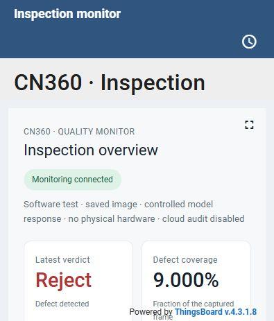
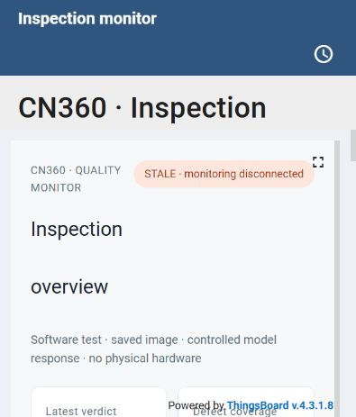

# ThingsBoard software integration — 3 November 2026

Software integration is verified with real ThingsBoard CE 4.3.1.8, real n8n,
and the new durable local monitoring bridge. The operator dashboard is
provisioned and visually checked. This is software acceptance, not acceptance
of the vision model or physical conveyor.

## Automated acceptance

The saved-image test used a real JPEG prepared from
`test-assets/product-defects/bottle__good__000.png`. Its vision responses,
camera/controller transport, database and relay were controlled recording
boundaries. It executed the repository's actual inspection graph in disposable
n8n and read the resulting telemetry back from actual ThingsBoard.

| Scenario | Inspection response | Visible in ThingsBoard |
| --- | --- | --- |
| No detections | Pass | 1,119 ms |
| Box covering 25% of frame | Reject | 821 ms |
| Model error | Error, fail-closed reject | 735 ms |
| Model exceeds timeout | Error, fail-closed reject | 2,028 ms |
| ThingsBoard stopped | Pass; monitoring journal retained the event | Replayed after restart |
| Inspection after recovery | Reject | 2,670 ms |

The run also verified:

- The assigned operator can read the dashboard and acknowledge the actual
  native **Inspection failure** alarm.
- The dashboard contains no machine-control widgets.
- Inspection completes while the actual ThingsBoard container is stopped.
- The retained event appears after the actual platform restart.
- Absolute inspection counts remain correct after recovery.
- Missing coverage is displayed as **Unavailable**.

The complete machine-readable record is [acceptance.json](acceptance.json).
Six focused monitoring tests cover durable restart/deduplication, execution ID
reuse, lost HTTP acknowledgements, HTTP outage recovery, component health
formats and post-response workflow isolation. The n8n suite has 218 passing
tests, including explicit offline labels and prevention of fabricated snapshot
uploads when cloud storage is disabled.

## Existing online software profile

The existing saved-picture test was also run with the real controller C++ core
on the PC, the real relay and actual Supabase Database/Storage. Pass, reject
and model-error cases appeared in ThingsBoard with correct coverage and
separate controller acceptance. The test preserved the current cloud path:

- Three inspection rows: `pass`, `reject`, and failure-fallback `reject`.
- Three accepted controller-action records.
- Three stored snapshot URLs.

See [online-audit.json](online-audit.json). No cloud credentials are included.

## Offline demonstration and remaining boundary

`thingsboard/scripts/start-demo.ps1` starts the local monitoring platform and
the saved-image/PC-controller profile with cloud audit calls explicitly
disabled. The original online runtime settings are preserved. The test page,
HUD and ThingsBoard label this mode, and the local delivery journal persists
its monitoring events. It needs cached Docker images, Python/Pillow and the
built controller adapter; no cloud credential is required for this mode.

The final offline saved-image run appeared in ThingsBoard in **615 ms**,
reported 9.000% defect coverage and an accepted PC-controller response, and
delivered a `detections` message to the actual relay with no fabricated stored
snapshot URL. All cloud HTTP nodes were disabled and the online runtime settings
were preserved. See [offline-demo.json](offline-demo.json).

The bridge heartbeat lets the dashboard mark old data as stale after 25
seconds. Component health is polled every 10 seconds. The controlled test
responses establish orchestration and failure reporting, not actual defect
detection quality. Model quality, physical item retention/rejection, real
sensor/actuator timing, camera deployment and Pico acceptance remain the next
stage.

